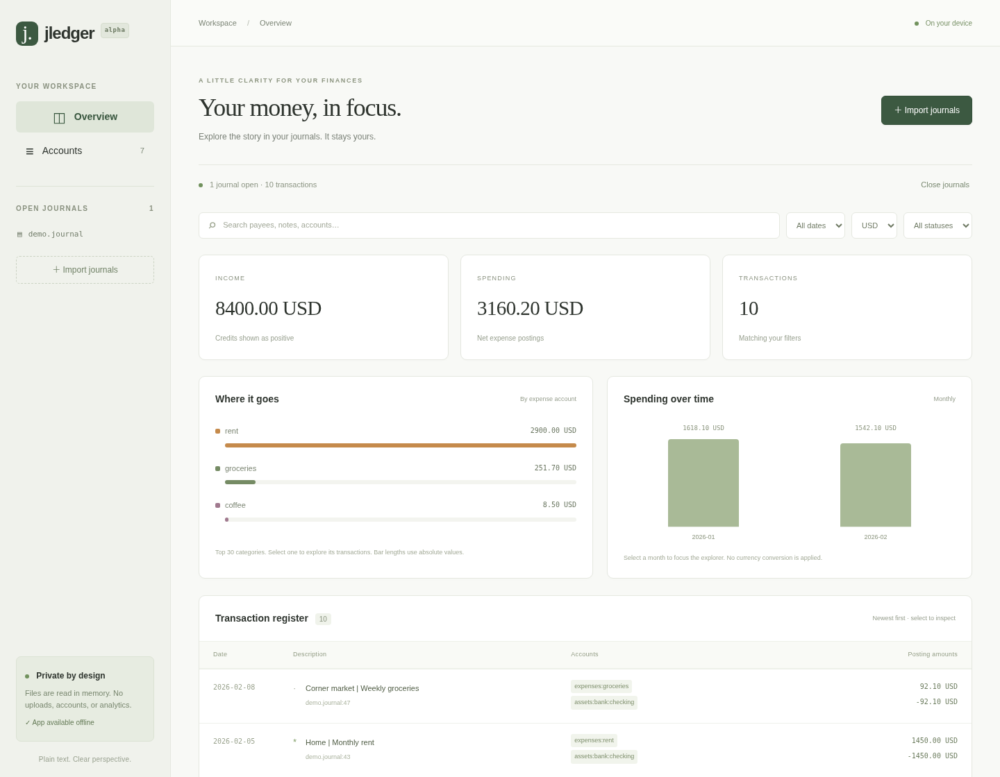

# jledger

Private, local-first plain text accounting tools in JavaScript and TypeScript.
The web explorer is the primary product: open journal files, understand your money,
and keep your financial data on your own device.



**Early prototype:** this is a working foundation, not a Ledger or hledger replacement.
The parser implements a small, strict subset of hledger's journal format.
Unsupported input disables reports instead of silently dropping financial data.
Read the [compatibility contract](docs/compatibility.md) before using real journals.

## Get started

Use Node **24.x** (see `.node-version`) and **pnpm 11.25.0** (see `packageManager`).
Run these commands at the repository root:

```sh
pnpm install --frozen-lockfile
pnpm build
pnpm dev
```

Choose **Explore sample journal**, or import/drop one or more UTF-8 journals.
Imports replace the currently open set; choose all files together. The current
limit is 256 MiB total. Includes are not resolved yet and produce errors.
The development server listens on all interfaces for cloud development; it serves
only the app and synthetic demo, and never automatically reads `LEDGER_FILE`.
Use the loopback CLI server below for personal journals.

## CLI

From the repository root:

```sh
pnpm jledger -f packages/examples/demo.journal check
pnpm jledger -f packages/examples/demo.journal balance
pnpm jledger -f packages/examples/demo.journal server
# The equivalent after building:
node packages/cli/dist/index.js -f packages/examples/demo.journal server
```

The server prints its local address. Open it in a browser on the same machine.
It serves the production explorer and only the selected journal files. It binds
to `127.0.0.1`, is read-only, and has no arbitrary file browser or upload endpoint.
After editing a journal in your editor, choose **Reload files**. There is no file
watcher yet. The server requires a root-path web build (`pnpm build`).

File selection follows this precedence for **every CLI command**, including `server`:

1. Explicit `-f/--file` switches. Repeat them for multiple files; they replace the environment selection.
2. A nonempty `LEDGER_FILE`. An environment glob selects the alphabetically first matching file, as in hledger.
3. `~/.hledger.journal`.

```sh
LEDGER_FILE="$HOME/finance/main.journal" pnpm jledger server
pnpm jledger -f "$HOME/finance/2025.journal" -f "$HOME/finance/2026.journal" check
pnpm jledger server --file "$HOME/finance/personal.journal" --port 4000
```

`~/` expansion is supported. Quote shell glob patterns if you intend them to be
resolved by `LEDGER_FILE`; explicit `-f` arguments are literal file paths.
Duplicate files (including symlink aliases) are rejected. A missing selected file
is an error; it never silently falls back to a different journal.
The `jledger` executable belongs to the CLI package; the root `pnpm jledger`
script is the source-development entry point. npm publication/standalone
installation is a later milestone.

## What works

- Browser-only imports and drag-and-drop, with no upload or account requirement.
- Exact decimal balances, separated by commodity; no floating-point money arithmetic.
- Interactive expense categories and monthly charts, plus date, status, commodity,
  account, and text filters. Income/spending classification currently uses English
  `income`/`revenue`/`expenses` account prefixes, case-insensitively.
- A transaction register with posting amounts and source references, transaction
  details, inferred amounts, and original source snippets.
- A direct account-balance view. These are full-journal balances, independent of
  register filters; parent/subaccount rollups are not implemented yet.
- The same production client served statically or through the local CLI.
- An offline application shell after the first successful production load on
  HTTPS or loopback. Journal contents stay in memory and must be reimported after
  a reload. Local-server files can be reread while that server is running.

Charts use approximate floating-point dimensions only; displayed/report totals
use exact decimal strings. Parsing, indexing, search, and exact report totals run in a web worker. The register
and accounts use TanStack Virtual; every result is browsable without rendering
the entire journal into the DOM. Only visible transaction windows cross to the UI.
Search is debounced and stale searches are cancelled. See [performance](docs/performance.md).

## Workspace

| Package             | Responsibility                                                              |
| ------------------- | --------------------------------------------------------------------------- |
| `packages/core`     | Runtime-neutral parser, diagnostics, decimal arithmetic, balances           |
| `packages/web`      | React, Vite, TanStack Start SPA, Tailwind, shadcn/Base UI, TanStack Virtual |
| `packages/cli`      | Node file access, file-selection policy, reports, loopback server           |
| `packages/examples` | Synthetic journals shared by demos and tests                                |

The parser stays inside core initially. See the [roadmap](docs/roadmap.md) and
[architecture](docs/architecture.md) for milestones and open design decisions.

## Validate

```sh
pnpm check                   # lint, typecheck, unit/integration cases, production builds
pnpm exec playwright install chromium  # once, if a browser is not installed
pnpm test:browser            # production imports, filters, details, privacy, offline, server
pnpm format:check            # oxfmt; pnpm format applies formatting
```

The [compatibility corpus](docs/conformance.md) runs offline in `pnpm test`.
Use `pnpm test:compatibility` with pinned hledger 1.52 and Ledger 3.3.2
executables to verify live reference results.

To use an installed Chromium, set `PLAYWRIGHT_CHROMIUM_EXECUTABLE_PATH` to its path.
The browser suite starts its own loopback server. The standalone subpath check is:

```sh
JLEDGER_BASE_PATH=/jledger/ pnpm --filter @jledger/web build
JLEDGER_TEST_BASE_PATH=/jledger/ pnpm test:browser
pnpm build                   # restore the root-path build for jledger server
```

`pnpm typecheck` prepares core's declarations. On a fresh checkout, run `pnpm build`
before the first typecheck so TanStack can generate its route tree.

## Static deployment

The manual GitHub Actions [Pages workflow](.github/workflows/pages.yml) builds
for `/jledger/` and uploads **only** `packages/web/dist/client`.
Enable GitHub Pages with GitHub Actions as the source, then manually run the workflow.
No deployment has been performed by bootstrapping this repository.
For a custom domain or a `*.github.io` root site, change the base path to `/`.
Keep personal journals outside this checkout or under ignored `private/`.
Never include them in a public directory, examples, build artifacts, or a commit.

The static application requests only its own bundled assets. No remote fonts,
analytics, market quotes, or third-party scripts are used. Offline support caches
only build-time application files (including the journal worker), never journal API responses or imported files.
Browser extensions, a compromised host, and other users on the same OS remain
outside this prototype's privacy boundary; see [architecture](docs/architecture.md).

## Contributing

Use a short, lowercase [Conventional Commit](https://www.conventionalcommits.org/)
subject and a detailed, helpful body explaining the change, why it is needed, and
how it was validated. For example:

```text
feat(web): add account drill-down

Connect expense category selections to the transaction register so people can
trace a chart total back to its postings and source journal lines.

Validate category filtering, clearing filters, and multi-commodity journals.
```

No project license has been selected yet. Choose one before public distribution;
links to other projects are references, not a grant to reuse their implementation.
