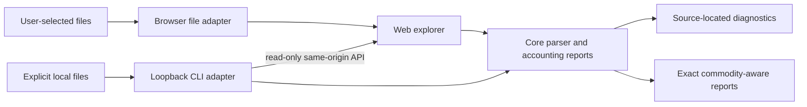

# Architecture

## One engine, two ways to open a journal

The browser uses a dedicated module worker for parsing, indexing, full-text filtering,
and exact report aggregation. React receives metadata, aggregate results, on-demand
details, and only the visible transaction window. TanStack Virtual bounds the
register and account DOM. [Date ranges](explorer-filters.md) are inclusive and
match the same posting as account and commodity filters. The worker and visible rows share that matcher;
range errors are validated independently of journal diagnostics.
Active filter chips and bounded named presets copy only the seven-field report
configuration on the UI thread. Presets are scoped to the worker's successful-load
revision, so replacing/reloading a journal resets them even with identical names.
Failed file reads preserve the prior session. Applying a snapshot uses the same
query/debounce/cancellation flow and clears selected details; financial computation
stays in the worker. Presets are never written to URLs or browser storage. Searches debounce
for 100 ms; worker scans yield between chunks so newer searches cancel stale work. Files and local-server JSON are read
in the worker, keeping large payload decoding off the UI thread.

[Account rollups](account-hierarchy.md) are computed from direct balances in core
and built in the worker, together with a subtree/fold index. Summaries expose counts;
the virtualized account list requests bounded row windows for inclusive or direct
mode. Expand/collapse changes visibility without changing balances or report scope.
Account-name search uses a normalized worker-side name cache and parent indices,
revealing matches with ancestor context without changing balances or register scope.
It debounces for 100 ms, invalidating pending view/window IDs immediately. Clearing
search restores the prior folds. Independent load/view/window IDs discard stale
account responses without cancelling financial queries. The committed load ID remains usable after failed replacement
attempts. Import state commits atomically after report/index construction;
hierarchy-limit errors retain the previous complete import and folds with a warning.
[Journal-defined account types](account-types.md) retain declaration/tag provenance
in core. An isolated cached resolver is created in the worker per import; filtered
income/spending uses its canonical classifications. Only on-demand transaction
details carry classification provenance to React. Unsupported/conflicting types
disable every report; there is no persisted browser classification configuration.

Core consumes named UTF-8 source strings and returns transactions and diagnostics.
Source files remain authoritative; derived reports are disposable. Locations retain
file names and line numbers. Quantities are decimal strings with exact BigInt-backed
addition, so JSON and browser/Node boundaries do not lose precision.
[Explicit amount formats](amount-formats.md) normalize input punctuation using
string operations. Decimal marks follow file/include scope; commodity styles flow
through include expansion in source order. No format context is transferred to the
UI or applied as rounding to financial report quantities.
[Plain balance assertions](assertions.md) are checked after successful parsing and
transaction balancing, in effective posting-date order across the expanded bundle.
[Explicit default years](default-years.md) resolve month/day transaction headers
from file/include context without consulting the clock. Includes inherit the year
and restore their parent on return; independent roots start unset. Canonical dates
are established before assertions/reports, while optional inferred-year provenance
reaches on-demand transaction details. Month/day posting overrides use the resolved
transaction year, independently of the active directive; secondary and continuation date forms remain errors.
[Primary posting dates](posting-dates.md) also drive monthly charts and filters;
transaction rows retain their original date and expose posting overrides.
The running-balance pass is skipped when no assertions are present. Assertion
failures disable the complete report set.
The present accounting parser is a strict subset, not a complete journal grammar.
It streams the [source-preserving syntax layer](syntax.md), whose line nodes retain
full source spans and distinguish comments, postings, headers, directives, and
unknown text. Callers can explicitly retain a read-only tree and reconstruct its
original decoded text exactly; the explorer does not retain that extra tree.
The [selected-source include graph](includes.md) preserves directive order while
requiring every target in the supplied bundle. A complete grammar and safe
transformation API are still needed before authoring is introduced.

The UI uses React, Tailwind CSS, and a shadcn-style Base UI Button component with
local ownership of its source and styling. `components.json` supplies shadcn aliases.
No third-party UI implementation is copied without retaining its license notice.

Start prerenders a generic document for the client-only (`ssr: false`) explorer
route, producing a static SPA with complete route hydration metadata. It has no server
functions and does not receive journal data during builds. The CLI serves only the
client artifact, not Start's SSR build. This keeps the static-host and local-server
interfaces identical. Start's server features remain available if a concrete future
need arises, but the explorer must continue to work without them.

There is currently one route. Additional static routes will need prerendering or a
GitHub Pages-compatible navigation strategy; do not assume Pages rewrites unknown
URLs to an SPA shell. Base paths are explicit in Vite, the router, and the worker.

## Read-only local adapter

`jledger server` resolves file-selection precedence once, binds only to IPv4
loopback, and exposes `GET /api/journals`. The endpoint accepts no path parameters.
A reload rereads only the selected paths. Literal relative `include` directives
resolve among that explicit file allowlist in core; they never cause filesystem
discovery. Source names are relative to the selected files’ common directory.
Canonical selected paths are revalidated on each read, and final symlink opens are
refused. The common directory is a naming boundary, not authority to read its other
files. The browser enters this mode only with `?local=1`;
ordinary static visits do not probe a journal endpoint.

Host validation, origin checks, Fetch Metadata checks, no CORS, no-store responses,
and a restrictive response CSP protect this local endpoint from ordinary cross-site
access and DNS rebinding. Static asset realpaths must remain inside the asset root.
These controls are covered by integration tests. This is a single-user local tool,
not an authenticated network service; other processes/users on the host may reach
loopback. Do not add a public bind address without a separate authentication design.

## Privacy and offline behavior

- Import uses the File API. Parsing, filtering, and chart aggregation run locally in the journal worker.
- No upload, telemetry, external scripts, remote fonts, or market-price requests.
- Original files are never written. Import replaces the current in-memory set.
- No localStorage, IndexedDB, or browser file-handle persistence is used yet.
- The production service worker precaches an explicit list of public build assets;
  it never runtime-caches arbitrary requests and ignores all `/api/` requests.
- Worker cache versions are derived from asset content. Cache cleanup is scoped
  to this application and base path. Reloading offline restores the app, not the
  journal. Reimport to continue exploring offline.
- Closing a journal clears application state. It cannot guarantee secure erasure
  from browser/OS memory, extensions, crash dumps, or developer tools.
- A published static host can change the JavaScript it serves. A trusted self-hosted
  build or loopback distribution gives users control of the executable application.

A future opt-in persistence feature needs an explicit privacy UX, a forget-data
control, storage-lifetime rules, and a threat model. Browser encryption without
independent key handling must not be advertised as protection from compromised
application JavaScript.

## Package boundaries

Keep the parser in core while its types and report semantics evolve together.
Extract `@jledger/parser` only when a stable grammar/AST API or independent consumers
justify versioning it separately. Avoid a UI package until there is genuine reuse.
Examples form a workspace package so the web demo and tests share actual fixtures.

The CLI's current web-asset location assumes this monorepo layout. Standalone npm
packaging needs a deliberate asset-bundling step and install smoke tests. Do not
claim that publishing the current CLI package alone supplies the web application.

## Testing strategy

Vitest covers exact arithmetic, supported syntax, rejection paths, known balances,
file selection, and HTTP privacy controls. Playwright exercises the built client,
including import, filters, drill-down, diagnostics, offline reload, and selected
server journals. The static subpath run exercises a GitHub Pages-style location.

The [versioned conformance corpus](conformance.md) compares a small synthetic
subset with pinned hledger 1.52 and Ledger 3.3.2 executables. It separates
reference acceptance, posting semantics, and direct report parity. Extend its
coverage alongside each parser change. Neither a shared
file extension nor a passing demo constitutes full compatibility.

Large-journal checks and current limits are documented in [performance](performance.md).
